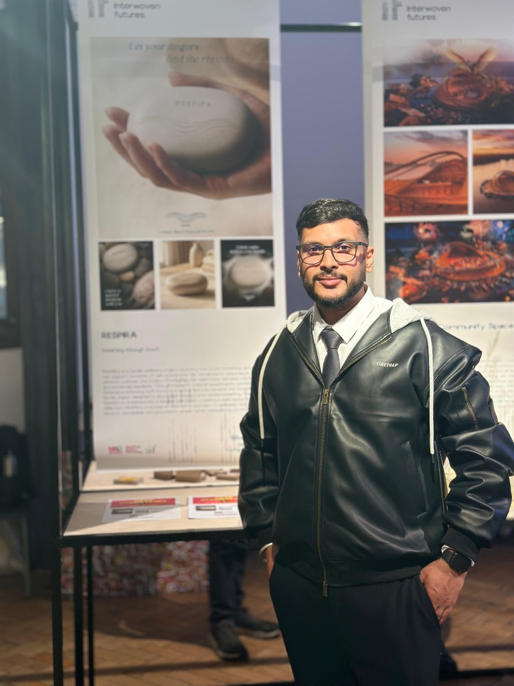

# Bhanu Partap — Graphic Designer Portfolio

> A premium portfolio showcasing the work, research and visual identity of **Bhanu Partap** — Graphic Designer, brand storyteller and packaging-focused creative based in Sheffield, UK.



---

## 🧑‍💼 About

**Bhanu Partap** is a dark-themed, animated personal portfolio built with React + TypeScript + Vite. It showcases his design work, research, awards, packaging concepts and multidisciplinary creative practice as a graphic designer and visual storyteller based in Sheffield, UK.

---

## ✨ Features

- 🎨 **Premium dark UI** with glassmorphism, smooth gradients, and motion design
- ⚡ **Framer Motion & Anime.js** — spring physics, magnetic interactions, 3D tilt cards
- 🖼️ **Dual portrait showcase** (Exhibition & Studio) with animated crossfade switcher
- 📱 **Fully responsive** — mobile, tablet, and desktop optimised
- 🧭 **Multi-page SPA** — Home, About, Research, My Works, Customers, Contact
- 🔗 **Live social links** — LinkedIn, Behance, Email
- 🔖 **Custom favicon & brand icon** with brand identity
- 🌐 **SEO-ready** meta tags and semantic HTML

---

## 🏗️ Tech Stack

| Layer | Technology |
|---|---|
| Framework | React 19 + TypeScript |
| Build Tool | Vite 6 |
| Styling | Tailwind CSS v4 |
| Animation | Framer Motion + Anime.js v4 |
| Icons | Lucide React |
| UI Utilities | Radix UI, class-variance-authority |

---

## 📁 Project Structure

```
portfolio/
├── public/              # Static assets (favicons, images)
├── src/
│   ├── Assets/          # Images (profile photos, brand icon)
│   ├── components/
│   │   ├── layout/      # Navbar, Footer
│   │   ├── sections/    # HeroSection, FeaturesSection, InteractiveGallery
│   │   └── ui/          # AnimeTiltCard, Magnetic, AnimCounter, AboutSection…
│   ├── hooks/           # useAnime.ts (magnetic, 3D tilt, counter hooks)
│   ├── pages/           # HomePage, AboutPage, ResearchPage, ContactPage…
│   └── lib/             # Utils
├── index.html
├── vite.config.ts
└── package.json
```

---

## 🚀 Getting Started

### Prerequisites
- Node.js ≥ 18
- npm ≥ 9

### Install & Run

```bash
# Install dependencies
npm install

# Start development server
npm run dev
```

Open [http://localhost:3000](http://localhost:3000) in your browser.

### Build for Production

```bash
npm run build
```

---

## 🔗 Contact & Links

| Platform | Link |
|---|---|
| 🌐 Portfolio | [Bhanu Partap Portfolio](https://www.behance.net/bhanupartap5) |
| 💼 LinkedIn | [linkedin.com/in/bhanu-partap-041b55277](https://www.linkedin.com/in/bhanu-partap-041b55277) |
| 🎨 Behance | [behance.net/bhanupartap5](https://www.behance.net/bhanupartap5) |
| 📧 Email | [Bhanupartap1711@gmail.com](mailto:Bhanupartap1711@gmail.com) |
| 📞 Phone | +44 7311725356 |

---

## 📄 License

This project is private and owned by **Bhanu Partap**. All design assets, photography, and written content are the exclusive property of Bhanu Partap. Not licensed for redistribution or commercial use.

---

<p align="center">
  Built with ❤️ by <strong>Bhanu Partap</strong> — Graphic Designer
</p>
